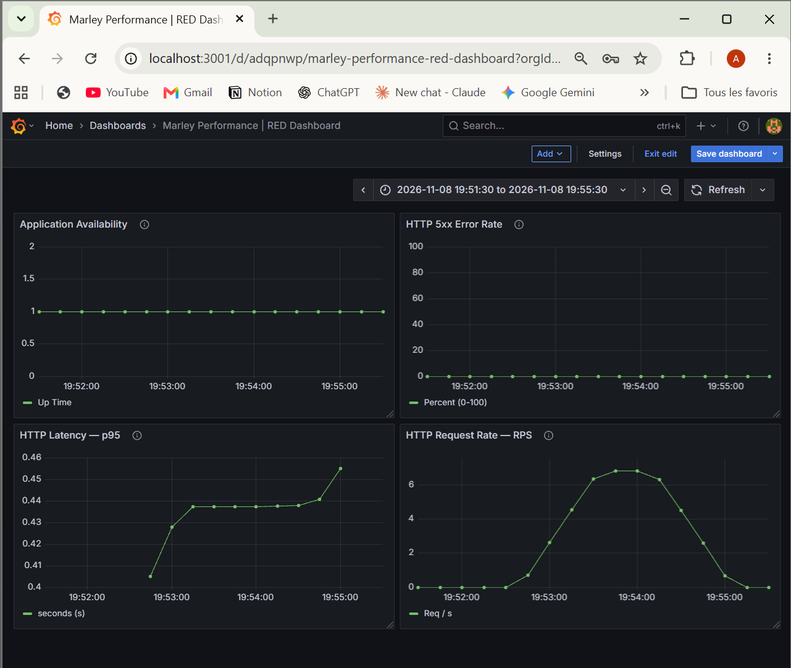

# Marley Performance — Rapport d'investigation

## 1. Contexte

Projet personnel DevPerfOps visant à mesurer, diagnostiquer
et améliorer les performances d'une API HTTP.

Stack :
- Python / Flask
- Gunicorn (workers synchrones)
- Docker Compose
- k6
- Prometheus
- Grafana

## 2. Problématique

Une application peut répondre à 100 % des requêtes HTTP
tout en présentant des temps de réponse dégradés.

Objectif : comprendre l'impact du nombre de workers
Gunicorn sur la latence et le débit d'une API.

## 3. Hypothèse

Avec un worker synchrone unique, les requêtes lentes
peuvent retarder les autres requêtes.

L'augmentation du nombre de workers devrait réduire
l'attente côté client lorsque plusieurs requêtes
arrivent simultanément.

## 4. Protocole expérimental

Application :
- GET /fast : sleep(0.08)
- GET /slow : sleep(0.4)

Générateur de charge :
- k6
- 5 utilisateurs virtuels
- 90 secondes
- Environ 80 % de /fast et 20 % de /slow
- Pause de 300 ms par itération

Variable modifiée :
- Nombre de workers Gunicorn : 1, 2, puis 4

Indicateurs :
- Latence moyenne
- Latence p95
- Requêtes par seconde
- Taux d'échecs HTTP

Seuil expérimental :
- p95 < 700 ms
- Taux d'échecs HTTP < 1 %

## 5. Résultats

| Workers | Requêtes | RPS | Moyenne | p95 | Échecs |
|---|---:|---:|---:|---:|---:|
| 1 | 627 | 6.88 | 422.44 ms | 1380 ms | 0 % |
| 2 | 961 | 10.64 | 168.11 ms | 443.69 ms | 0 % |
| 4 | 1009 | 11.19 | 145.24 ms | 401.65 ms | 0 % |

Résultats obtenus lors d'une première campagne
par configuration.

## 6. Analyse

Passage de 1 à 4 workers :

- Réduction du p95 : environ 70.9 %
- Augmentation du débit : environ 62.6 %
- Aucun échec HTTP observé

Le passage à 2 workers produit déjà une amélioration
importante.

Le passage de 2 à 4 workers améliore encore les
résultats, mais dans une proportion plus limitée.

Ces observations sont cohérentes avec l'hypothèse
d'une attente liée au worker unique.

Elles ne prouvent pas à elles seules que cette attente
constitue l'unique cause de la dégradation.

## 7. Observabilité

Prometheus collecte les métriques Flask.

Grafana présente :
- Débit HTTP
- Durée p95 des requêtes
- Taux d'erreurs HTTP 5xx
- État de la collecte Prometheus

Limitation : l'instrumentation actuelle Flask
ne fournit pas une agrégation multi-processus
fiable pour l'ensemble des workers Gunicorn.

Les conclusions comparatives reposent donc
sur les mesures k6 côté client.

### Dashboard Grafana — Configuration mono-worker

## 8. Limites de l'expérience

- Environnement local WSL2 / Docker
- Une seule exécution par configuration
- Pas de relevé CPU/mémoire documenté
- Charge fermée à 5 utilisateurs virtuels
- Application volontairement simplifiée
- Endpoints simulant des traitements par sleep()
- Pas de validation sur un environnement distribué
- Pas de benchmark représentatif d'une production

Le seuil p95 < 700 ms est un critère expérimental,
pas un SLO métier validé.

## 9. Conclusion

Sous la charge testée, le passage de 1 à 4 workers
Gunicorn a réduit le p95 mesuré par k6 d'environ
70.9 % tout en augmentant le débit moyen de 62.6 %.

L'expérience illustre qu'une application peut
être disponible tout en répondant trop lentement.

Prochaines investigations :
- Répéter les campagnes
- Mesurer CPU et mémoire
- Vérifier la stabilité des résultats
- Ajouter le tracing distribué
- Étudier les métriques multi-processus
- Tester des charges plus importantes
